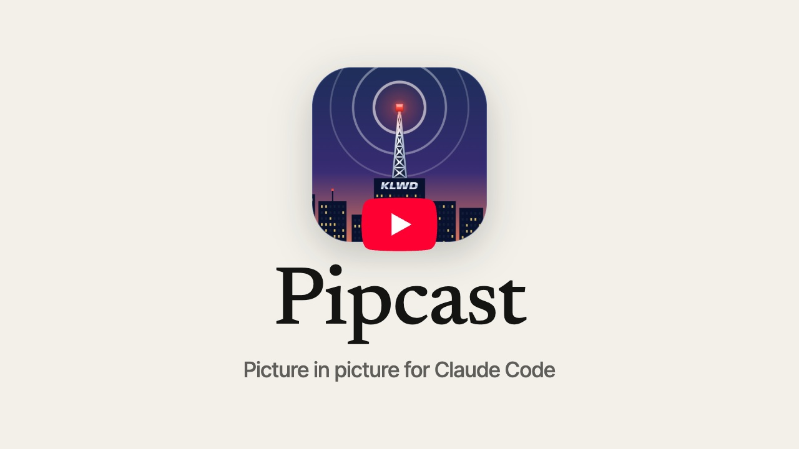
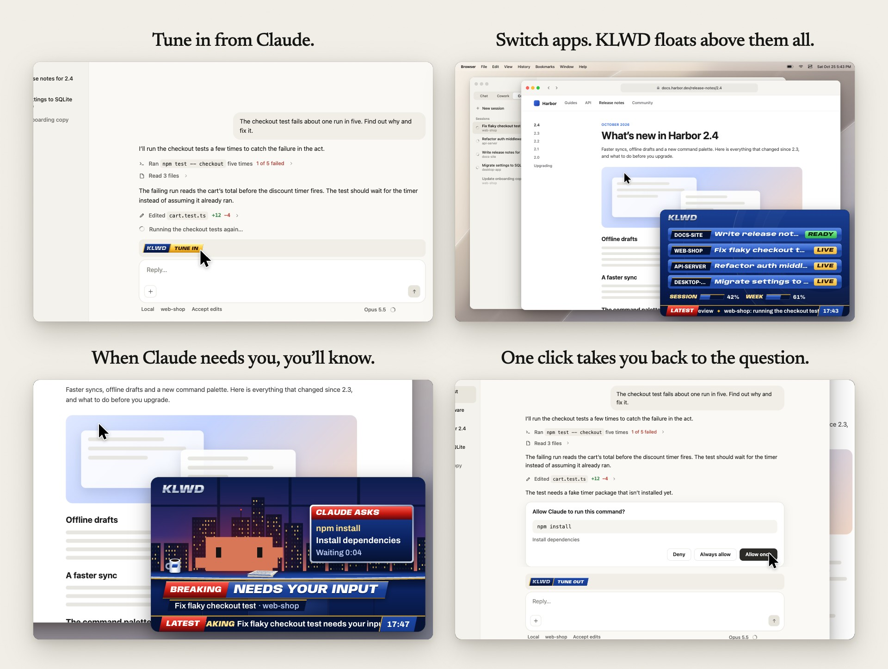
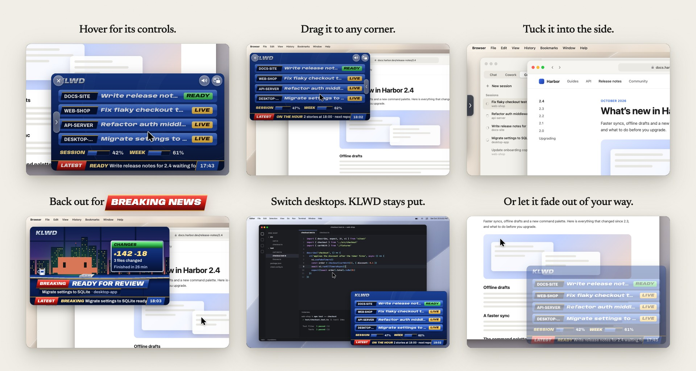

<p align="center"></p>

# Pipcast

**Picture in picture for Claude Code.**

Start Claude on something, switch to another app, and keep an eye on it from the corner of your screen. Pipcast puts a small window there that floats over whatever you're working in, the way a video does when you pop it out into picture in picture, and shows you what your Claude Code sessions are up to. When one needs you, finishes, or stops on an error, you see it and hear it, without going back to check.

What plays in the window is KLWD, a local TV news channel for your sessions, styled as a 1990s local news broadcast. Most of the time it shows a live board of your sessions. When something happens, KLWD cuts to BREAKING NEWS and Clawd reads the story from the anchor desk. Every hour on the hour, it airs a short report on what each session did.

<p align="center"><a href="https://youtu.be/WZc3zm6nB9g"></a></p>

<p align="center"></p>

## Requirements

- A Mac with Apple silicon, on macOS 14 or later. The window's controls use Liquid Glass on macOS 26 and later.
- The Claude desktop app, with Claude Code. Sessions you run in Claude Code in a terminal can tune in with `/pipcast` too. Pipcast is a mod for Claude Code, so it doesn't run in chat or Cowork.

## Install

Pipcast is in two places: Anthropic's plugin directory, and [erdembircan-plugins](https://github.com/erdembircan/plugin-marketplace), a marketplace of Claude Code plugins. Install it from one of them.

### From Anthropic's plugin directory

1. In the Claude desktop app, or on claude.ai, open **Customize**, then **Plugins**.
2. Under **Discover**, find **Pipcast** and select **Add**.
3. Start a new Claude Code session, signed in to the same account. If Pipcast isn't on in it yet, run `/reload-plugins` in that session, or start another one.

On a Team or Enterprise plan, the directory shows only if your organization keeps it.

### From erdembircan-plugins

In the Claude desktop app, click **+** next to the prompt box, then **Plugins**. Choose **Add marketplace**, enter `erdembircan/plugin-marketplace`, and add **Pipcast**.

Or from a terminal:

```bash
claude plugin marketplace add erdembircan/plugin-marketplace
```

```bash
claude plugin install pipcast@erdembircan-plugins
```

Sessions you start after that have it.

## Get started

1. Start a new session in the Claude desktop app. It goes on air by itself.
2. Give Claude something to do, then switch to another app. KLWD appears in the bottom-right corner of your screen.
3. When the session needs your input, finishes, or stops on an error, KLWD airs it as BREAKING NEWS.
4. Click **Back to Claude** on the window, or switch to Claude yourself, and the window gets out of the way.

A session that was already open, or one you resume, goes on air when you press **TUNE IN** in the band above the prompt box, or run `/pipcast`. The band shows **TUNE IN** in gold while the session is off the air and **TUNE OUT** in blue while it's on. Press **TUNE OUT**, or run `/pipcast` again, to take the session off the air.



## What's on


### The board

The board is KLWD's live picture of every session on air, one row each: its project, its title, and where it stands.

| State | Means |
| --- | --- |
| **INPUT** | It's waiting on you: a question, or a permission to give |
| **ERROR** | It stopped on an error |
| **READY** | It finished, and it's ready for you to look at |
| **LIVE** | Claude is working on it |

The sessions that need you come first: INPUT, then ERROR, READY and LIVE. Within INPUT and ERROR, the session that has waited longest is at the top; within READY and LIVE, the one that changed last. There's no limit on how many sessions can be on air: with more than four, the board shows four at a time and turns to the next four every 8 seconds.

Under the board, two meters show your account's usage limits: the current session's and the week's. They turn gold from 70% and red from 90%.

### BREAKING NEWS

Every story gets its own segment: the BREAKING NEWS stinger and its jingle, then Clawd reading what happened at the anchor desk, with a beat under the story, then back to the board. A session has a story when it needs your input, when it finishes with changes ready for review, when it finishes without changing anything (WORK COMPLETE, with Claude's last words), and when it stops on an error.

Stories air one after another, in the order they land, and nothing cuts in. KLWD only airs what happens while you're away from Claude: switch back to Claude, and the stories still waiting are dropped, since you can see them for yourself.

### On the hour

At the top of every hour, the station clock strikes, Clawd reads the headlines, and THE HOUR IN REVIEW shows what each session did: the lines it changed, or how long it has been waiting on you. If you're in Claude as the hour strikes, that hour is skipped, and the next report covers it.

## The window



The window looks and works like macOS's picture in picture for video: a 16:9 window with rounded corners that floats above every app, the Dock and the menu bar, on every desktop.

- **It never takes the keyboard.** Whatever you're typing in keeps typing.
- **It hides while Claude is in front**, where you can see your sessions anyway, and comes back when you switch away.
- **Move it** by dragging it to another corner. **Resize it** by dragging an edge, down to 70%.
- **Tuck it away** by pressing the handle on its inner edge, or by dragging a quarter of it past the side of the screen. It slides into that side and leaves a small tab, as picture in picture does on iPhone and iPad. BREAKING NEWS and the hour still bring it out, and it goes back when they end. Click the tab to bring it back for good.
- **Hover over it** for its controls:
  - **Close** takes every session off the air and closes the window. Tune a session in again to bring it back.
  - **Mute** turns the jingles and the beat off, and **Unmute** turns them back on. The window remembers which. Sound plays at your Mac's volume.
  - **Back to Claude** brings the Claude desktop app to the front.
- **Let it fade** with **Transparent window**, under Settings: it fades to 40% while the pointer is elsewhere, so you can see what's under it.

The window is there while at least one session is on air, and closes a few seconds after the last one tunes out.

## Settings

| Setting | Default | What it does | Change it |
| --- | --- | --- | --- |
| **Tune in every new session** | On | Each new session in the desktop app goes on air as it opens, and so does the new session a `/clear` starts. With it off, every session waits for **TUNE IN** | `/pipcast auto on` or `/pipcast auto off` |
| **Transparent window** | Off | The window fades to 40% while the pointer is elsewhere, so you can see what's under it, and turns solid again as soon as the pointer is on it. Everything still airs as before | `/pipcast transparency on` or `/pipcast transparency off` |

Run `/pipcast auto` or `/pipcast transparency` on its own to see whether that setting is on. A change to **Tune in every new session** applies to sessions that start after it; a change to **Transparent window** reaches the window within a second.

### Commands

| Command | Does |
| --- | --- |
| `/pipcast` | Tunes this session in, or out if it's on air |
| `/pipcast auto [on\|off]` | Shows or sets **Tune in every new session** |
| `/pipcast transparency [on\|off]` | Shows or sets **Transparent window** |

## What Pipcast runs and reads

Pipcast is two programs, and both run only on your Mac.

**The mod** is Pipcast's code inside Claude Code. It runs in every Claude Code session while Pipcast is on, on air or not, so a session that goes on air mid-turn shows where it stands at once. It draws the band above the prompt box, answers `/pipcast`, and follows each session's events: the session starting and ending, prompts sent, turns starting and ending, the tools Claude calls, permission requests and errors. From a prompt you send, it takes only the session's title and where its transcript is, never the prompt itself.

The mod reads:

- what each tool call is about: the file it reads or edits, the command it runs, the site it fetches from, and the text of a question Claude asks you
- what a permission request is for: the command, file, site or tool
- Claude's last message when a turn ends
- the session's title, from the file Claude Code keeps beside the session's transcript in `~/.claude/projects`, and the note there that names the folder a subagent works in
- your account's usage limits, as Claude Code reports them
- the environment variables `HOME`, `CLAUDE_CONFIG_DIR` and `CLAUDE_CODE_EXECPATH`, and `PIPCAST_HOME`, `PIPCAST_STATION_BIN` and `PIPCAST_TARGET_BUNDLE_ID`, which are for Pipcast's own tests

It writes a session's file only while the session is on air, and it runs these programs and no others:

- `git`, only to read (`rev-parse`, `diff-index` and `ls-files`), in the folders where Claude works, and it reads the files there that git doesn't track yet, to count the lines each session changes
- `ps`, `lsof`, `head` and `tail`, when a turn ends with commands still running in the background, to tell from their processes and the start and end of their output whether they're still at work
- `find`, to find the folder of the session's transcript when no hook has said where it is
- `sh` and `ps`, to find the Claude Code program the session runs on, and that program's `claude plugin list` and `claude plugin configure`, when you run `/pipcast auto` or `/pipcast transparency`
- `mkdir`, `mv`, `rm` and `chmod`, on its own files
- the station

**The station** is a small macOS app that comes with Pipcast: the program `station/pipcast-station` in the plugin, built from the Swift source in Pipcast's repository. The mod starts it when the first session goes on air, and it quits a few seconds after the last one goes off. It reads the sessions' files, shows the broadcast in its window, a web page that comes with the plugin, and plays the jingles and the beat in `station/sounds`. It checks which app is in front, to hide while Claude is, and where the pointer is, to show the window's controls. Its window never takes the keyboard, so macOS treats the station as an app in the background, and three private macOS switches, looked up as it runs, make up for that: one draws the window's glass controls as an active window's, one lets the station set the pointer for resizing, and one keeps the window off Claude's full-screen desktop. For Pipcast's own checks, it has a `snapshot` command that draws a still of its page, and it saves a picture of its own window, and no other, when `PIPCAST_SELF_CAPTURE` is set. It asks for no permission: no screen recording, no accessibility, no automation.

Neither part makes a network request, and neither downloads or installs anything.

## Privacy

Everything stays on your Mac. Pipcast sends nothing anywhere, and has no account, analytics or telemetry.

It keeps its files in one folder, `~/Library/Application Support/Pipcast`, which only your user can open:

- a file for each session on air, with its project's folder name, its title, its state, what Claude is doing, the question Claude asked or what a permission is for, Claude's last words when a turn ends, the lines and files it changed in each hour, and your account's usage limits. A session deletes its file when it goes off the air or ends. A file left behind by a session that stopped without ending, as when Claude Code is force-quit, is deleted the next time a session goes on air, once it's an hour old.
- the window's corner and size, whether it's tucked into the side, whether sound is on, when the hour last aired, when the window was last closed, **Transparent window**, and the station's process number and version
- the station's own log of what its window did, for fixing problems, cut back at 1 MB

Claude Code keeps Pipcast's two settings with your other plugins' options.

Uninstalling Pipcast leaves that folder in place. To remove everything Pipcast kept, delete `~/Library/Application Support/Pipcast`.

KLWD is an ordinary window, so it appears in screen shares and recordings, with your session titles and Claude's questions on it. Tune sessions out, or close the window, before you share your screen.

## Update and uninstall

**From Anthropic's plugin directory**, Pipcast updates by itself: once a new version is out, new sessions get it. To uninstall it, open **Customize**, then **Plugins**, open **Pipcast**, open its menu and select **Remove**. New sessions start without it.

**From erdembircan-plugins**, update or uninstall it from a terminal, then start a new session:

```bash
claude plugin update pipcast@erdembircan-plugins
```

```bash
claude plugin uninstall pipcast@erdembircan-plugins
```

Either way, uninstalling leaves the files Pipcast kept in `~/Library/Application Support/Pipcast`. Delete that folder to remove them too.

## Development

Pipcast is built from the source in this repository: a mod that runs in each Claude Code session, a native macOS station that owns the window, and the broadcast that plays in it. To work on it, see [docs/development.md](docs/development.md): how the parts fit together, how to build and test it, how to try a change in the desktop app, and how the demo video and the README's screenshots are made. [docs/architecture.md](docs/architecture.md) has the details.

## License

MIT, generated and verified with [license-wizard](https://github.com/erdembircan/license-wizard). The fonts in `assets/fonts` are under the SIL Open Font License; their license files sit beside them.
