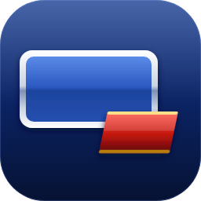
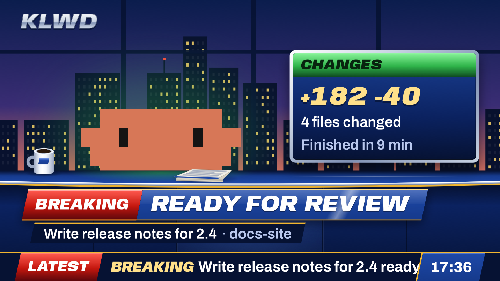

<p align="center"></p>

# Pipcast

**KLWD, a local TV news channel for your Claude Code sessions.**

Pipcast puts a small window in a corner of your screen that airs your Claude Code sessions as a 1990s local news broadcast. The channel is KLWD. Most of the time it shows a live board of the sessions you tuned in. When one of them needs you, finishes, or stops on an error, KLWD cuts to BREAKING NEWS: a stinger, then the anchor desk, where Clawd reads the story, then back to the board. Every hour on the hour it airs a short report on what each session did.

The window shows only while you're in another app. Switch back to Claude and it gets out of the way.

<p align="center"></p>

## What it does

- **Tune in from Claude.** Press **TUNE IN** in the band above the prompt box, or run `/pipcast`. Up to four sessions can be on air at once.
- **The live board.** Each session on air gets a row with its title and its state on a pill: INPUT when it needs you, ERROR when it stopped on an error, READY when it finished, LIVE while it works.
- **BREAKING NEWS for every story.** A session that needs your input, that is ready for review, whose work is complete, or that stopped on an error airs as its own segment. Stories air one after another, in the order they land. Nothing cuts in, and a story you already dealt with in Claude is dropped.
- **On the hour.** The station clock strikes the hour, Clawd reads the headlines, and THE HOUR IN REVIEW shows what each session did.
- **A window that stays out of the way.** It fills its quarter of the screen, resizes down to 70% from its edges, and moves to another corner when you drag it there. It floats above every app and never takes the keyboard.
- **Controls on hover.** Close stops tracking every session, the speaker turns the jingles on and off, and Back to Claude brings Claude to the front.

## Requirements

- macOS 14 or later, on Apple silicon. The window's controls use Liquid Glass on macOS 26 and later.
- The Claude desktop app, with Claude Code.

## Install

In the Claude desktop app, click **+** next to the prompt box, then **Plugins**. Choose **Add marketplace**, enter `erdembircan/pipcast`, and add **Pipcast**.

From a shell:

```bash
claude plugin marketplace add erdembircan/pipcast
```

```bash
claude plugin install pipcast@pipcast
```

New sessions load it.

## Use it

1. In a Claude Code session in the desktop app, press **TUNE IN** in the band above the prompt box, or run `/pipcast`.
2. Switch to another app. KLWD appears in the bottom-right corner of the screen.
3. When the session needs you or finishes, KLWD airs it as BREAKING NEWS.
4. Hover over the window for its controls. Drag it to move it to another corner, or drag an edge to make it smaller.
5. Press **TUNE OUT**, or run `/pipcast` again, to take the session off the air.

The four cells in the band show how full KLWD is: blue for each session on air, gold for this one. With four sessions on air, **TUNE IN** dims until one tunes out.

## How it works

Pipcast has three parts.

- **The mod**, in `plugin/`, runs inside each Claude Code session. It draws the band, answers `/pipcast`, follows the session's events, and writes what it sees to a small file for that session.
- **The station**, in `station/`, is a native macOS app with one always-on-top window. It reads every session's file and plays the broadcast in that window.
- **The broadcast**, in `packages/`, is what plays in the window: the director that decides what airs and when, and the KLWD graphics from the design system in `design/`.

The sessions and the station talk only through files in `~/Library/Application Support/Pipcast`. [docs/architecture.md](docs/architecture.md) has the details.

## Privacy

KLWD is an ordinary window. It appears in screen shares and recordings, with session titles and Claude's questions on it. Everything stays on your Mac: nothing is sent anywhere.

## Develop

Pipcast builds with Node.js 22 or later and the Swift toolchain that comes with Xcode or its Command Line Tools.

```bash
npm ci
```

```bash
scripts/build.sh
```

builds the station, the broadcast and the band's artwork into `plugin/`, where the mod runs them. Commit what it builds: an install copies `plugin/` as it is.

```bash
scripts/test.sh
```

runs every check: lint, types, the unit tests of each part, the station's Swift tests, and the mod's manifest and kit tests on the engine bundled with the Claude desktop app.

```bash
scripts/verify.sh
```

runs the whole thing for real, with no window of yours involved: a headless Claude Code session tunes in, the station starts and shows its window, the session tunes out, and the station quits.

To try a change in the desktop app, add your clone as a marketplace:

```bash
claude plugin marketplace add ~/Developer/JS/pipcast
```

## License

MIT, generated and verified with [license-wizard](https://github.com/erdembircan/license-wizard). The fonts in `assets/fonts` are under the SIL Open Font License; their license files sit beside them.
